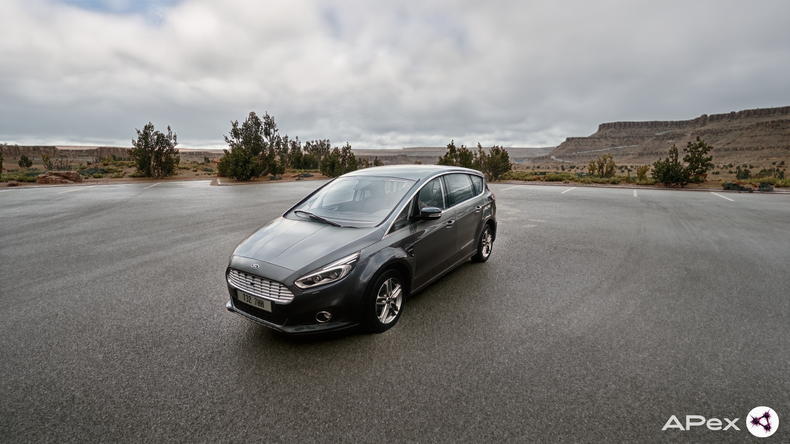
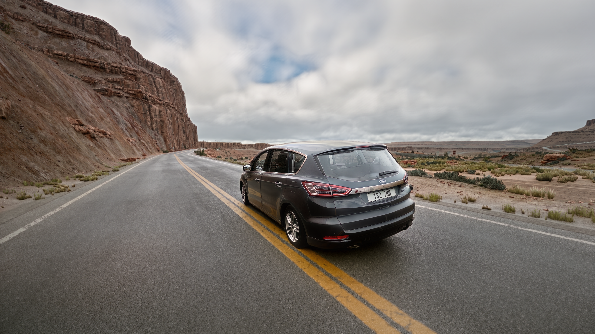
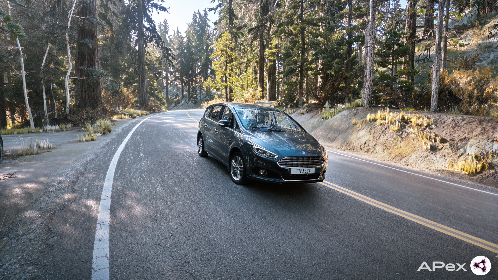
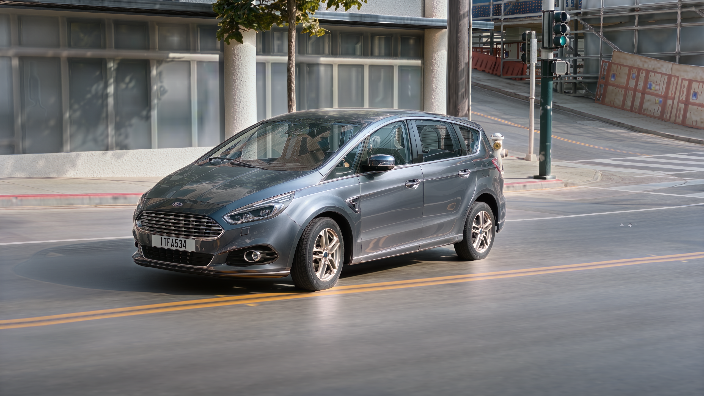

# APex — DLSS 5 Graphics Preset for BeamNG.drive

**Created & Configured by APex**

A custom DLSS 5 graphics preset for BeamNG.drive, developed and configured by APex.

The goal of this project is to improve the visual realism of BeamNG.drive through custom graphics settings.

---

## Preview

*Screenshots showcasing the preset:*

<!-- Add your screenshots below -->

---

## Project Information

- **Author:** APex
- **Project:** BeamNG.drive DLSS 5 Preset
- **Version:** 2.0
- **Release year:** 2026
- **Game:** BeamNG.drive

## Features

- Custom DLSS 5 configuration
- Individually adjusted visual settings
- Focus on realistic lighting and image quality
- Created for BeamNG.drive

## Requirements

- NVIDIA RTX 20 / 30 / 40 / 50 series GPU
- Latest compatible NVIDIA drivers
- BeamNG.drive
- ReShade and the required DLSS 5 files

**Performance notice:** DLSS 5 may significantly reduce FPS and increase VRAM usage. Performance and stability depend on your hardware and settings.

## Installation

See the installation guide included with the release.

## Version History

### v2.0 — 2026
- Updated custom graphics settings
- Adjusted visual appearance
- Improved overall visual realism

---

## Author & Usage

This preset was created and configured by **APex**.

Please do not claim this preset as your own work. If you share or showcase it, credit the original author and link to the official source.

For usage and redistribution conditions, see [AUTHOR_INFO.txt](AUTHOR_INFO.txt).

**Official community:** [APex_Sector](https://t.me/APex_Sector)

---

© 2026 APex. All rights reserved.
